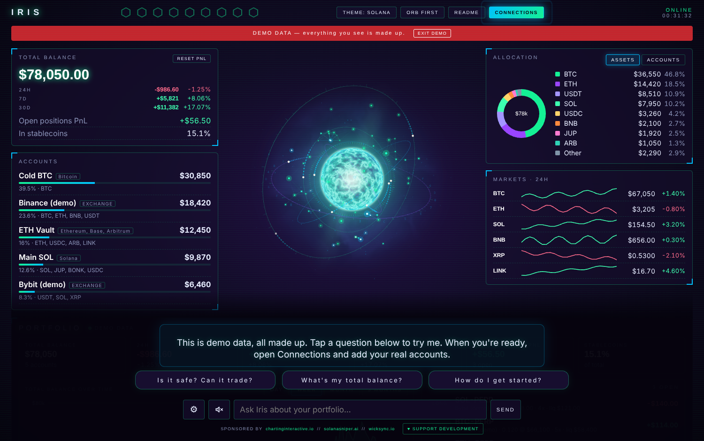
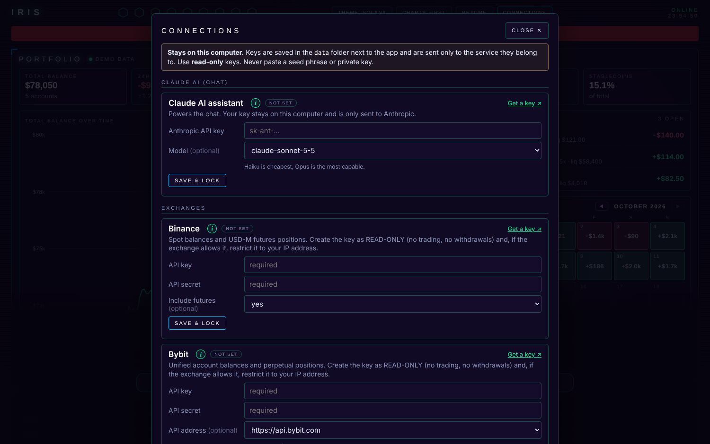

# IRIS

**Your crypto control room, running only on your own computer.**
Connect your exchanges, wallets and social accounts, see everything in one place with charts, and ask an AI assistant about your numbers.



- **One total balance** across your exchanges (Kraken free; Binance, Bybit and more with Pro), wallets and stocks & commodities, with 24h / 7d / 30d PnL
- **Charts:** balance over time, allocation donut, daily-change calendar, live market sparklines (the MARKETS panel follows the coins you hold; with no holdings yet it shows the 8 biggest coins by market cap)
- **Open futures positions** from all exchanges in one list (side, size, entry, leverage, liquidation, PnL)
- **Wallets by address only:** Solana, Ethereum + Base / Arbitrum / Optimism / Polygon / BNB Chain, Bitcoin, Hyperliquid
- **Socials:** followers, 24h / 7d / 30d growth and likes / views of recent posts for YouTube, Instagram, X, Telegram and Discord
- **AI assistant** (Claude): *"How did I do this week?"*, *"How much BTC do I hold across everything?"*, *"How are my socials growing?"*
- **Market pulse** (next to Socials): important news and data releases the moment they come out (Federal Reserve, US jobs and inflation numbers, SEC, CoinDesk, Cointelegraph, Decrypt, The Block), the economic calendar with Fed meetings, the Fear & Greed index and a mood score. Free public sources, **no key or account needed**. Iris says the breaking items out loud, warns before big events (FOMC, CPI, jobs), mentions what matters in the startup briefing and can answer *"What is the market sentiment right now?"*. Switch the voice with **MARKET ALERTS** in the gear menu.
- **9 colour themes:** Solana (the default), Iris Cyan, Matrix, Tokyo Night, Ultraviolet, Synthwave, Bitcoin, Red Team and Carbon. Click **THEME** in the top bar to cycle through them (or pick one in the gear menu); your choice is remembered.
- **A live assistant that follows your data:** besides the answers below, when nothing has happened for about five minutes it adds a short spoken observation about a different part of the app (balance, biggest holding, a position, the market mood, the next Fed event, your fastest growing social, the calendar), and the three question bubbles rotate across every section and fill with questions about whatever just changed. Without a Claude key it answers these data questions itself, straight from the numbers on screen. It opens with a spoken briefing (greeting by time of day, balance, PnL, positions, socials), suggests questions that fit what is happening right now, and announces important changes out loud: a 3% balance move, a position opening or closing (with the result in percent and dollars), a position close to liquidation, an account that stops responding, a follower milestone, a position passing 10 / 25 / 50 percent, one account moving on its own, a coin you hold moving 5 percent or more, the day turning green or red, or the market mood changing. Switch the announcements with **ALERTS** in the gear menu.
- **Read-only by design.** There is no code anywhere that trades, transfers or withdraws.
- **Demo mode** so you can look around before connecting anything. Iris welcomes you with a spoken intro (press **HEAR THE INTRO** to replay it), and until you add a Claude key a built-in guide answers basic questions (what is this, how do I start, is it safe, what is my total balance) for free.

Everything is optional: add only what you use, and each section fills in as soon as it has data.

---

## Quick start

### Windows: the installer (no Python, nothing else to install)

1. Download **`Iris-Setup.exe`** from the [latest release](https://github.com/reporushkavalki/iris_ai_agent/releases/latest) (or from the Iris website) and double-click it.
2. Windows may show a blue **"Windows protected your PC"** box, because the installer is not signed with a paid certificate. Click **More info**, then **Run anyway**. The code is all open here on GitHub.
3. Iris installs for your user only (no administrator rights) and opens in its own window. Start it later from the Start menu.
4. Click **CONNECTIONS** and add what you want, or click **TRY DEMO DATA** to look around first. Press the small **(i)** next to any key, wallet or social to see exactly how to get it.

**Updating:** download the new `Iris-Setup.exe` and run it. Your keys, wallets and history are not in the program folder but in `%APPDATA%\Iris`, so an update (or uninstalling and reinstalling) never touches them. To remove Iris completely, uninstall it in *Settings → Apps*, then delete the `%APPDATA%\Iris` folder if you also want the data gone.

### macOS, Linux, or running from the source (needs Python)

You need **Python 3.10 or newer** ([python.org/downloads](https://www.python.org/downloads/), on Windows tick *"Add python.exe to PATH"*).

1. Download this project (green **Code** button, then **Download ZIP**) and unzip it.
2. Start it:
   - **Windows:** double-click **`LAUNCH IRIS.bat`**. The first time, Iris also creates a shortcut called **Iris** on your Desktop. If it doesn't appear, open the gear menu in Iris and press **ADD DESKTOP ICON**.
   - **macOS / Linux:** open a terminal in the folder and run `bash start.sh`. The first start also puts a **Iris** icon on your Desktop (macOS: double-click `Iris.command`; Linux: `Iris.desktop`, and on some desktops right-click it once and choose *Allow Launching*). macOS may ask you to allow it the first time (right-click → Open). On Linux you need `python3-venv` (`sudo apt install python3-venv` on Debian/Ubuntu).
3. Your browser opens the dashboard at `http://127.0.0.1:8765`. The first start installs a few packages (about a minute).
4. Click **CONNECTIONS** and add what you want, or click **TRY DEMO DATA** to look around first.
5. This guide is also inside the app: press **README** in the top bar.

To stop it, close the window (or press `Ctrl+C`). Your settings and history stay in the `data` folder next to the program. **To update,** download the new zip, copy your old `data` folder into the new folder (or run `python app.py --import-data "<old data folder>"`; an existing file is never overwritten), and delete the `.venv` folder once so the packages refresh.



---

## Free and Pro

Iris is free to download. The free plan is small on purpose, four things:

1. **Claude AI chat** with your own Anthropic key (the free chat uses Claude Haiku 5.5)
2. **Kraken** (the one free exchange: it serves the US, the EU and the UK)
3. **Wallets** (public addresses)
4. **Stocks & commodities** typed in by hand (Yahoo Finance prices, often delayed about 15 minutes; an optional free Finnhub key gives steadier US prices with Pro)

Together the free plan connects up to **5 accounts**. Everything else is listed in Connections with a 🔒 and the PRO tag: Binance, Bybit, OKX, MEXC, Bitget, KuCoin, Gate.io, Alpaca (US stocks broker), Trading 212, Coinbase (all beta), social accounts (YouTube, Instagram, X, Telegram, Discord) and the advanced keys.

**Iris Pro** unlocks every connection, removes the account limit, includes the **advanced Iris AI** (Claude Sonnet 5.5; the chat works without any Claude key, within a monthly allowance), DeFi data (yields and protocol sizes) and gives early access plus the Inner Circle. Price: **$9.99 a month or $89.99 a year**. Paste the license key under **Connections > Iris Pro**. Connections you saved before stay working. Your own Claude key, if you add one, is always used first.

---

## What to connect

Open **CONNECTIONS** (top right). Each card has an **(i)** button that explains step by step how to get the key, a *Get a key* link, takes the key, **locks** it, and has a **TEST** button.

| Connect | What you paste | Permission to give the key |
|---|---|---|
| **Claude AI** (chat, free) | Anthropic API key | n/a. Usage is billed by Anthropic to your account; short questions cost a fraction of a cent. |
| **Binance** *(Pro)* | API key + secret | Enable Reading only. Spot + USD-M futures are read. Funding / Earn wallets are not included. |
| **Bybit** *(Pro)* | API key + secret | Read-only. Unified account + perpetual positions. |
| **OKX** *(Pro)* | API key + secret + passphrase | Read only. Trading + funding account and positions. |
| **MEXC** *(Pro)* | API key + secret | "View account details" + "View order details". Spot + futures. |
| **Kraken** | API key + private key | "Query funds" only. Spot incl. staked assets. |
| **Bitget** *(Pro, beta)* | API key + secret + passphrase | Read-only. Spot + USDT futures. |
| **KuCoin** *(Pro, beta)* | API key + secret + passphrase | "General" only. Spot, trading and funding balances. |
| **Gate.io** *(Pro, beta)* | API key + secret | Read-only. Spot + USDT futures margin. |
| **Alpaca** *(Pro, beta)* | Key ID + secret | Alpaca keys cannot be read-only, so keep it private. Iris only reads. US stocks, ETFs, crypto, cash. Paper account supported. |
| **Trading 212** *(Pro, beta)* | API key + secret | Read permissions only. Shows invested value and cash (single positions are not listed yet). Practice account supported. |
| **Coinbase** *(Pro, beta)* | CDP key name + private key (ECDSA) | "View" only. All wallet balances. Needs the `cryptography` package (installed automatically). |
| **Stocks & commodities** | Type `SYMBOL AMOUNT` per line | Nothing. Needs no key. GOLD, SILVER, OIL ... and Yahoo symbols (NESTE.HE, VOD.L). |
| **Wallets** | A **public** address | Nothing. Solana, EVM (pick the networks), Bitcoin, Hyperliquid (beta). |
| **YouTube** *(Pro)* | Free YouTube Data API v3 key + `@handle` | n/a |
| **Instagram** *(Pro)* | Meta access token + numeric user id | Business or Creator accounts only (Meta's rule). |
| **X (Twitter)** *(Pro)* | Bearer token + username | X's free tier allows very few reads, so refreshes may be rate-limited. |
| **Telegram** *(Pro)* | Bot token (from @BotFather) + `@channel` | The bot must be in the channel. Shows the member count. |
| **Discord** *(Pro)* | Invite code only | No key needed. Shows members and how many are online. |
| **Solana RPC** *(optional, Pro)* | A free RPC URL (Helius, QuickNode ...) | The public RPC is rate-limited; your own is much more reliable. |

**TikTok** has no public API for this, so it isn't included.

When you press **TEST** on Binance, Bybit or OKX, Iris also checks whether the key can **trade or withdraw** and warns you if it can. If a key can withdraw, delete it and make a new read-only one.

### Wallet notes
- EVM wallets read the native coin plus the most common tokens (USDC, USDT, DAI, WETH, WBTC, LINK ...) per network. Other tokens are not listed because a node cannot enumerate them. You can add more in `iris/chains/evm.py`.
- Solana wallets list all SPL tokens that have a real market on DexScreener (thin-liquidity tokens are counted but not valued).
- Hyperliquid is marked **beta**: in unified-account mode, collateral can appear in both perps and spot.

---

## How PnL works

PnL is *the change in your balance* over the period (per account, summed). Iris keeps a snapshot every few minutes **while it is running**, so:

- It needs to have been running to know your past. Numbers marked `*` mean tracking started after the period began.
- Money you deposit from outside counts as a gain and money you withdraw counts as a loss. Moves between two of *your own* tracked accounts cancel out.
- A newly added account starts counting from the first moment Iris sees it, so a big starting balance is never shown as profit.
- **RESET PNL** starts the numbers and charts fresh.

---

## Safety: what is stored, and where

- Everything stays on **your computer**. The app listens on `127.0.0.1` only and rejects requests from other websites. In the Windows app the engine also needs a random secret that only the Iris window knows, so other programs and other Windows users on the PC can't read your data through it. **Never expose it to the internet.**
- Keys are saved in **`data/vault.json`** (in the Windows app: `%APPDATA%\Iris\vault.json`) on your computer, nowhere else. **On Windows the file is encrypted with your Windows account** (it only opens for you, on this PC; a copy on another PC or account is unreadable and Iris keeps it aside instead of overwriting it). On macOS and Linux it is a plain file that only your user can read. **Don't zip, share, sync or commit the `data` folder.** It is already in `.gitignore`.
- Once saved, a key is **locked**: the screen only shows a masked hint (`••••a1b2`), and it can't be replaced or removed until you click *Unlock*. This prevents accidents; the encryption above is what protects the file itself.
- Keys are sent only to the service they belong to (your exchange, Anthropic, Google, ...). The Iris page never gets a secret back from the server.
- Use **read-only** keys and, where the exchange allows, **restrict them to your IP address**.
- **Never paste a seed phrase or private key anywhere.** The wallet form rejects anything that looks like one.
- The AI can only call read-only tools. It sees your balances and positions (to answer you), and Anthropic receives those answers as part of the conversation under its normal terms.

If you ever shared a key by accident, delete it on the exchange's website and create a new one.

---

## Troubleshooting

| Problem | Try this |
|---|---|
| First start hangs on *Installing packages* / `ReadTimeoutError ... pypi.org` | Your connection to Python's package server is slow or blocked. Wait a few minutes (it retries), or close the window and run **LAUNCH IRIS** again; it continues where it stopped. Try another network or pause VPN / antivirus web-shield if it keeps timing out. |
| The launcher says Python was not found | Install Python 3.10+ from python.org and tick *Add to PATH*, then run again. |
| An account shows `HTTP 401` / `Invalid API-key` | Wrong key or secret, or the key is restricted to another IP address. Unlock the card, paste again, **TEST**. |
| Solana shows `429` / rate-limited | Add a free personal RPC URL under *Advanced*. |
| Totals look too low | Funding / Earn wallets (Binance) aren't read. Tokens without a public market price are listed as *unpriced*. |
| Markets panel is empty | The public price APIs (Binance / MEXC) may be blocked in your country or by your network. |
| No **Iris** icon on the Desktop | Close the Iris window completely and start it again with the launcher (the icon is made at start-up, so an already-running Iris won't make it). Or open the gear menu in Iris and press **ADD DESKTOP ICON**. If Windows blocks the normal shortcut, Iris falls back to a plain link file. Every attempt and its result is written to `data/shortcut.log`. |
| No voice at the very start | The welcome plays by itself once each time you start Iris. Browsers refuse to talk before your first click, so Iris then speaks through your computer's own voice instead (Windows, macOS, or Linux with `espeak-ng` or `speech-dispatcher` installed, e.g. `sudo apt install espeak-ng`); problems are written to `data/say.log` and shown on the page. If neither works, click anywhere on the page, or press **HEAR THE INTRO**. |
| Port 8765 busy | Iris picks the next free port and prints it in the window. |
| Windows app: "Iris stopped while starting" or it never opens | Close it, wait a few seconds and open it again. Security software sometimes holds the first start for a moment. If it keeps failing, reinstall with the newest `Iris-Setup.exe`; your data in `%APPDATA%\Iris` stays. |
| Windows app: "Your saved keys could not be opened" | The keys were saved by another Windows account or computer (they are encrypted to the account). Enter them again; the old file stays next to it as `vault.unreadable-….json` in `%APPDATA%\Iris`. |
| Windows app: no Phantom pop-up on the donate form | The app window has no browser extensions. Use the wallet-app link ("Pay from a wallet app") if you have Phantom Desktop installed, or copy the address and pay from your wallet. |
| Social card says rate-limited | X's free tier allows only a few reads. Others refresh every 5 minutes. |

---

## Building the Windows installer

The installer is built on GitHub, not on your computer: open the repository's **Actions** tab, choose **Windows app**, press **Run workflow**, type a version (for example `1.0.0`) and run it. After a few minutes the release appears under **Releases** with `Iris-Setup.exe`. The workflow runs the tests (including the real Windows key encryption), builds the engine with PyInstaller, wraps it in a Tauri window (`desktop/`), then installs and starts the result on a clean Windows machine before publishing.

```
desktop/iris-server.spec      PyInstaller recipe: Python + Iris as one hidden engine program
desktop/src-tauri/            the Tauri window (Rust): starts the engine, shows it, stops it
.github/workflows/windows-app.yml   the build and release
```

---

## For developers

```
app.py                  the local web server (FastAPI) and all /api routes
iris/providers.py      everything the Connections screen can configure (add a field here)
iris/exchanges/        one file per exchange; read-only balance + position calls
iris/chains/           wallet readers (solana, evm, bitcoin, hyperliquid)
iris/socials.py        social readers + follower snapshots
iris/portfolio.py      totals, snapshots, PnL, history, calendar
iris/tools.py          the AI's read-only tools          iris/agent.py  the Claude loop
iris/demo.py           made-up data for demo mode
iris/help_text.py      the text behind the (i) buttons
iris/guide.py          the built-in guide that answers before a Claude key is added
web/live.js             question bubbles, spoken alerts and the startup briefing
iris/market.py          market news, data releases, calendar and mood (free public sources)
web/market.js           the MARKET PULSE panel and its spoken alerts
iris/shortcut.py       the desktop icon (Windows / macOS / Linux)
iris/donate.py         the optional donation link (SOL)
iris/inner.py          the optional paid Telegram inner circle (see below)
web/orb3d.js            the COSMIC orb (WebGL + canvas); web/orb.js is the classic one
iris/say.py            speaks through the computer's own voice when the browser blocks speech
web/                    the dashboard (plain HTML, CSS and JavaScript; no build step)
tests/                  run with:  pip install -r requirements-dev.txt  then  python -m pytest
```

**Add an exchange:** copy `iris/exchanges/kraken.py`, implement `fetch()` (return `make_account(...)`), register it in `iris/exchanges/__init__.py`, and add its fields to `iris/providers.py`. The Connections screen, dashboard and AI pick it up automatically. Signing code should come with a test using the exchange's published example (see `tests/test_signing.py`).

---

## The orb

The **COSMIC** orb is a live picture of what Iris is doing: a plasma core with a ring of energy, a swarm of connected nodes with data flying between them, and lightning when new data arrives. It idles calmly, winds up while Iris thinks, sends out soft pulse rings while it speaks, flares on alerts, and follows your mouse (click it for a burst). It uses your graphics card through WebGL. If that is not available, or you prefer the older look, open the gear menu and press **ORB: COSMIC** to switch to the **CLASSIC** orb (the page reloads).

## Support the development (optional)

Iris is free. Once you have connected something (an account, a wallet, your social accounts or your Claude key) or turned on the demo data, a small **♥ SUPPORT DEVELOPMENT** button appears at the bottom of the page. It opens a short form: type how much SOL you want to give and press **DONATE WITH PHANTOM**. Phantom (or another Solana wallet) pops up, shows you the amount and the address, and only sends if *you* approve. Iris never sees a key and never sends anything by itself. No wallet extension? Use the wallet link or copy the address: `39oAW7hrufjNi6tm7bS35n3uRaxavV4hMD19y6UKyusU`. It also shows while the demo data is on, so you can try the form (the payment itself is real, so only press the final approve in your wallet if you mean it).

### Join the inner circle (optional)

The **★ JOIN INNER CIRCLE** button in the header (next to README and Connections) opens a private Telegram group run by the developer. You type your Telegram username, pay **0.2 SOL** with your own wallet (Phantom or any Solana wallet; you approve the amount and address), and when the payment is confirmed on the Solana chain your private invite link appears in the window. The link is made only for your @username: the group's bot lets in that person and nobody else, so a shared link is useless to others. Iris sends the server only your Telegram username and a random payment code. No key or balance leaves your computer.

*For the person who publishes Iris:* the payment check and the Telegram bot run on a tiny free server you set up once. It is in the `Iris_innercircle_server` folder with step-by-step instructions. After you set it up, paste its address into `iris/inner.py` (the line `API = ...`) before you publish. Until then the window shows "not open yet". The invite link and the bot token are never stored in Iris or on GitHub.

## Disclaimer

Iris is a viewing tool, not financial advice. Numbers come from third-party APIs and best-effort market prices and may be delayed, incomplete or wrong; check important figures on the exchange itself. Use at your own risk. MIT licensed (see `LICENSE`).

**Sponsored by** [chartinginteractive.io](https://promo.chartinginteractive.io) // [solanasniper.ai](https://solanasniper.ai)
